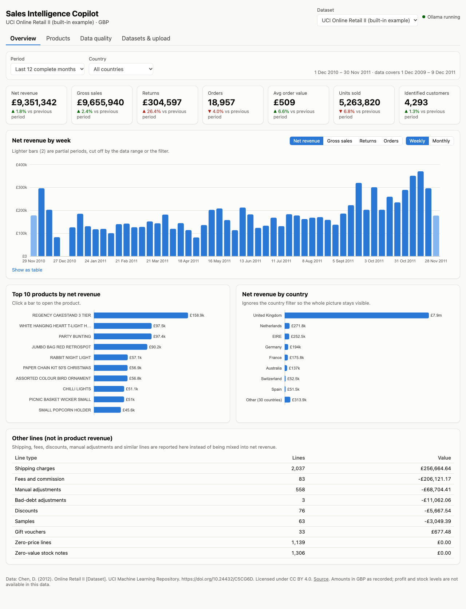

# Sales Intelligence Copilot

A local sales analytics application: an interactive dashboard, a forecasting model trained and evaluated on historical sales, and an AI assistant that answers business questions by calling validated analysis tools.

> **Status: Milestone 2 complete (data pipeline, dashboard, CSV upload).** Forecasting (Milestone 3) and the assistant (Milestone 4) are not built yet. See [PROJECT_STATUS.md](PROJECT_STATUS.md) for what is done and what is verified.



## What it does today
- **Built-in example data:** the UCI *Online Retail II* dataset (historical UK online gift-ware transactions, Dec 2009–Dec 2011, in GBP). It is cleaned with documented, evidence-based rules, and every row is accounted for. See [docs/data_cleaning.md](docs/data_cleaning.md) and [DATA_LICENSE.md](DATA_LICENSE.md).
- **Dashboard** at `http://127.0.0.1:8000`, in light or dark mode following the system setting:
  - Overview: KPIs with change versus the previous period, weekly/monthly trends with partial periods marked, top products, countries, and "other lines" kept out of revenue.
  - Products: searchable and sortable product table, with a trend chart for each product.
  - Data quality: every cleaning rule with row counts, values and evidence.
  - Datasets & upload: upload your own sales CSV through a template, column mapping, validation messages and a preview. Each upload is stored separately.
- **Definitions** used everywhere: net revenue = product sales − product returns. Shipping, fees, discounts and adjustments are reported separately. Profit and stock are not available in this data, and the app says so.

## Planned
- Weekly net-revenue forecasting that compares simple baselines with machine-learning models using time-based backtests (Milestone 3).
- A tool-using assistant powered by **Qwen3 4B Instruct running locally in Ollama** (`qwen3:4b-instruct-2507-q4_K_M`). The model chooses tools and the application code does every calculation (Milestone 4).

## Architecture
| Layer | Technology |
|---|---|
| Dashboard | React 19 + TypeScript, built with Vite; Apache ECharts |
| API | Python 3.13, FastAPI, served on `127.0.0.1` only |
| Data | pandas for reading, DuckDB SQL for cleaning and metrics (one database file per dataset) |
| Forecasting | scikit-learn (Milestone 3) |
| Assistant | Ollama (local), Qwen3 4B Instruct with tool calling (Milestone 4) |

All figures come from one metrics module (`backend/sic/metrics/`). The dashboard, and later the assistant and reports, call the same functions, so they always agree.

## Run it (macOS)
Prerequisites: uv, Node.js 24 LTS and Ollama. See [docs/setup-macos.md](docs/setup-macos.md) for verified install steps.

```bash
uv sync                                     # Python 3.13 + locked packages
npm ci --prefix frontend                    # dashboard packages
uv run python scripts/download_data.py      # official UCI file (~45 MB), with checksums
uv run python scripts/prepare_data.py       # clean and classify (~7 s)
uv run sic serve                            # builds the dashboard if needed, opens the browser
```

Checks:
```bash
uv run pytest                                   # 44 tests: metrics, rules, isolation, uploads, API
uv run python scripts/e2e_upload_check.py       # browser test of the upload journey (app must be running)
```

## Documentation
- [Data cleaning rules and evidence](docs/data_cleaning.md) · [Raw-data profile](docs/data_profile_uci.md) · [Data dictionary](docs/data_dictionary.md)
- [Qwen3 4B feasibility test](evaluation/llm_feasibility/2026-10-22_darwin-arm64.md) · [Memory checks](evaluation/memory/)
- [Screenshots](docs/screenshots/)

## Windows
Windows support is planned but **not yet verified**.

## AI-assisted development
This project is developed with Claude Code acting as a coding assistant under my direction. I set the requirements, made the data and design decisions (recorded in [PROJECT_STATUS.md](PROJECT_STATUS.md)), reviewed the results and verified them. The development history in Git reflects this honestly.
